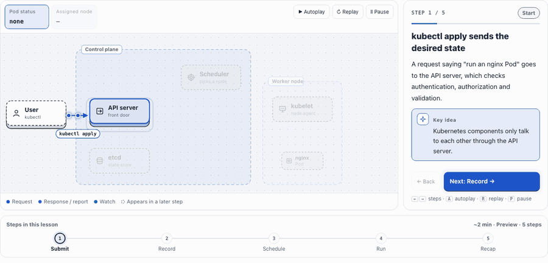

<div align="center">

# K8s Flow

**See how Kubernetes actually works, one animated step at a time.**

What happens after `kubectl apply`? 75 interactive lessons take you from cloud basics to Kubernetes internals, GPUs/NPUs on Kubernetes and LLM serving. Each step shows which components join in and where each request travels.

### 👉 [Open the site: spro1.github.io/kubernetes-study-web](https://spro1.github.io/kubernetes-study-web/)

No install, no sign-up. English and 한국어.

[](https://spro1.github.io/kubernetes-study-web/)

[](https://github.com/spro1/kubernetes-study-web/actions/workflows/deploy.yml)
[](https://github.com/spro1/kubernetes-study-web/stargazers)
[](LICENSE)

</div>

## Why

Kubernetes docs are full of sentences like "the API server writes to etcd, the controller watches and…". The order of events is hard to keep in your head from text alone.
K8s Flow draws that order. Each click brings in the next component and shows the request moving between them. Every step also gives the key idea, what to watch out for, and how state values change.

## What you get

- **Animated step-by-step diagrams.** Packets move along the real request path.
- **Autoplay.** Press <kbd>A</kbd> and the lesson plays like a short video.
- **Progress tracking.** Finished lessons get a ✓ in the sidebar and on the cards, and you can pick up where you left off. Progress stays in your browser, so there is no account.
- **English / 한국어**, dark mode, mobile layout, and support for reduced-motion settings.

## Tracks

Tracks go from easy to hard. The [lessons page](https://spro1.github.io/kubernetes-study-web/lessons) also maps the KCNA, CKAD, CKA and CKS exams to tracks.

| Track | Lessons | Covers |
| --- | :-: | --- |
| [Foundations: web, servers, containers](https://spro1.github.io/kubernetes-study-web/basic/web-request) | 6 | Web requests and HTTPS, servers to containers, images, Git and CI/CD. What to know before Kubernetes. |
| [Cloud basics](https://spro1.github.io/kubernetes-study-web/cloud/service-models) | 5 | IaaS/PaaS/SaaS, the VPC request path, availability-zone failover, auto scaling groups, IAM. |
| [Kubernetes core](https://spro1.github.io/kubernetes-study-web/basic/desired-state) | 8 | Desired state, workload types, how a Pod starts, Services and DNS, config and volumes, Jobs. |
| [Running workloads](https://spro1.github.io/kubernetes-study-web/intermediate/probes) | 11 | Probes, requests and limits, rolling updates, self-healing, graceful shutdown, HPA/VPA, StatefulSets, reading failures. |
| [Networking & service mesh](https://spro1.github.io/kubernetes-study-web/feature/service-types) | 7 | Service types, Ingress and TLS, NetworkPolicy, Istio sidecars, traffic splitting and gateways, entry points compared. |
| [Security & multi-tenancy](https://spro1.github.io/kubernetes-study-web/k8s/rbac) | 7 | RBAC, namespace quotas, Pod Security Standards, supply chain, runtime security, audit logs, threat modeling. |
| [Cluster operations](https://spro1.github.io/kubernetes-study-web/k8s/scheduling) | 7 | Scheduling, node drains, kubeadm upgrades, node troubleshooting, Kustomize, GitOps, SLO alerts. |
| [Kubernetes internals](https://spro1.github.io/kubernetes-study-web/advanced/api-request-path) | 8 | API request path, finalizers, CRDs and operators, etcd quorum, certificates, packet path, volume binding, preemption. |
| [AI on Kubernetes · GPU/NPU](https://spro1.github.io/kubernetes-study-web/ai/device-plugin) | 10 | Device plugins and DRA, sharing GPUs, model packaging, training jobs, cold starts, inference requests and routing. |
| [How LLM serving works](https://spro1.github.io/kubernetes-study-web/llm/token-generation) | 6 | Token generation, prefill and decode, KV cache, continuous batching, KV offloading, prefill/decode disaggregation. |

## Contributing

Corrections, translations and new lesson ideas are all welcome. Open an [issue](https://github.com/spro1/kubernetes-study-web/issues) or send a PR. See [CONTRIBUTING.md](CONTRIBUTING.md) for how lessons are built.

Each lesson is a single MDX file: `docs/<track>/<lesson>.mdx` for English and `i18n/ko/docusaurus-plugin-content-docs/current/<track>/<lesson>.mdx` for Korean. A lesson is one `<StepDiagram nodes={...} steps={...} />` element with node positions and per-step flows. Copying an existing lesson is the fastest way to start. The component's props are documented at the top of [`src/components/StepDiagram.jsx`](src/components/StepDiagram.jsx). The curriculum lives in [`src/data/tracks.js`](src/data/tracks.js); after adding or reordering lessons run `node scripts/build-lesson-index.js` to regenerate the lesson list and numbering.

```bash
npm install
npm start                 # English, http://localhost:3000/kubernetes-study-web/
npm start -- --locale ko  # Korean
```

Every push to `main` is built and deployed to GitHub Pages by GitHub Actions.

## License

Code: [MIT](LICENSE). Lesson content: [CC BY 4.0](LICENSE-CONTENT.md). Share and adapt freely with credit to K8s Flow.

---

## 한국어

**쿠버네티스가 실제로 움직이는 모습을 단계별 애니메이션으로 배운다.** 클라우드 기초부터 쿠버네티스 내부, GPU·NPU와 LLM 서빙까지 75개 레슨이 있다. 설치 없이 [한국어 사이트](https://spro1.github.io/kubernetes-study-web/ko/)에서 바로 볼 수 있다. 틀린 내용 제보와 레슨 제안은 이슈로 남겨 주세요.

---

<div align="center">

If K8s Flow helped you, a ⭐ **Star** helps others find it.

</div>
